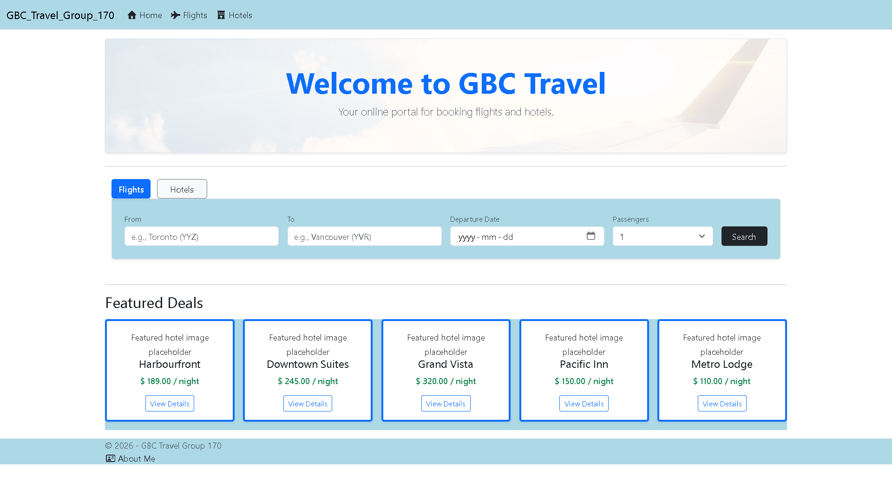
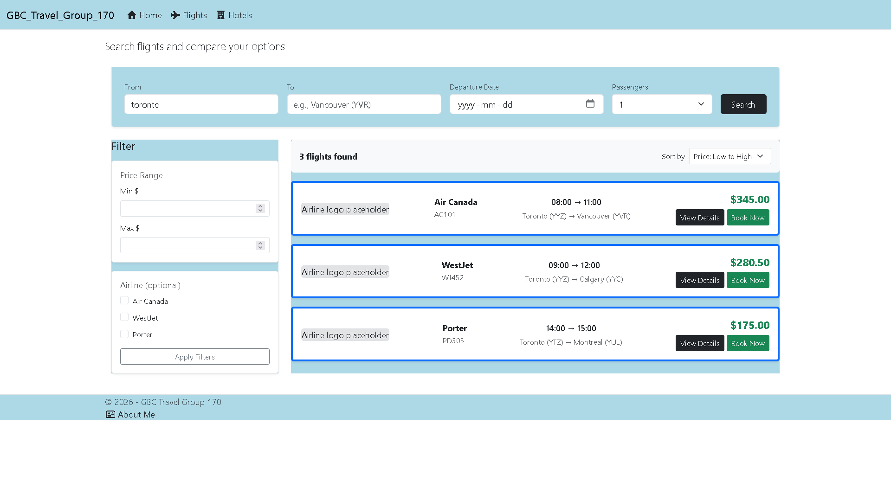
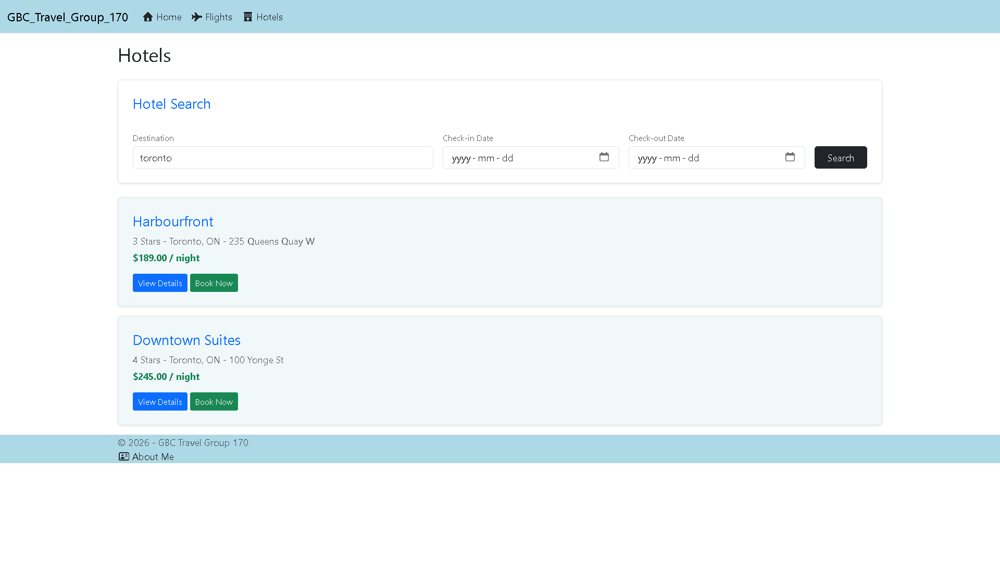

# GBC Travel (Group 170)

Welcome to **GBC Travel**, a full-stack ASP.NET Core MVC web application built for **COMP 2139 (Web Application Development)** at George Brown College. This application provides a modern, responsive portal for users to browse, search, and filter travel options for flights and hotels.

## Key Features

* **Database-Driven Architecture:** Built using Entity Framework Core and PostgreSQL, featuring automated database seeding (5 flights and 5 hotels) on startup.
* **Smart Search & Filtering:** Independent, case-insensitive search capabilities for both flights and hotels using PostgreSQL's `ILIKE` functionality.
* **Interactive UI:** A polished, responsive interface built with Bootstrap utilities and semantic HTML structure (no unnecessary wrapper divs).
* **Booking Confirmation Workflow:** A dynamic booking confirmation feature that captures item selections and displays confirmation details seamlessly.
* **Modern Hero Design:** Styled with a welcoming travel hero banner and custom color accents.

---

## App Preview

### Home & Search Portal

### Flight Search & Results from a Case Insensitive Query

### Hotel Details & Booking

---

## Tech Stack

* **Framework:** ASP.NET Core MVC (.NET 9)
* **Database & ORM:** PostgreSQL & Entity Framework Core
* **Styling:** Bootstrap & Custom CSS
* **Architecture:** Model-View-Controller (MVC) with Shared Data Context

---

## Author

**Kay Brooks**  
Computer Programming Diploma Program (T197)  
George Brown College (Fall 2026)